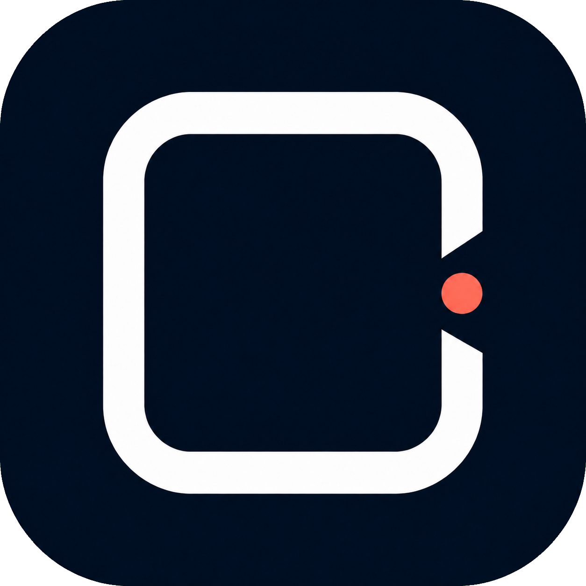

<p align="center"></p>

<h1 align="center">Touchless PPT Controller</h1>

<p align="center">举手翻页，专注讲课。用本地人体姿态识别，无接触控制 PowerPoint。</p>

<p align="center">Windows x64 · Microsoft PowerPoint · YOLO26s Pose · AGPL-3.0</p>

本项目使用官方预训练 YOLO26s Pose 模型识别上半身姿态，再把动作转换为 PowerPoint 指令。**没有自行制作数据集或重新训练模型**；ONNX 权重是同一模型的格式转换。识别在本机完成，正常使用不需要网络，也不自动保存相机画面。

当前公开版本：**[v0.2.0-beta.3](https://github.com/Evangelioonnn/touchless-ppt-controller/releases/tag/v0.2.0-beta.3)**。这是 Windows 测试版，不是已覆盖所有设备的稳定版。仓库从这版开始，只提供这一版源码和 Release，不上传本地旧版本、开发环境或私人测试材料。

## 下载与使用

前往 **[Release 下载页](https://github.com/Evangelioonnn/touchless-ppt-controller/releases/tag/v0.2.0-beta.3)**：

| 文件 | 用途 |
| --- | --- |
| `TouchlessPPTController-v0.2.0-beta.3-windows-x64-setup.exe` | 普通用户首选：安装后从快捷方式打开 |
| `TouchlessPPTController-v0.2.0-beta.3-windows-x64-onnx-candidate-portable.zip` | 免安装：完整解压后打开根目录的 EXE |
| `TouchlessPPTController-v0.2.0-beta.3-source-candidate.zip` | 本版对应源码，也可以克隆仓库的同名标签 |
| `TouchlessPPTController-v0.2.0-beta.3-models.zip` | 开发/恢复工程用的原始 PT、ONNX 和模型清单；普通用户无需另下 |
| `SHA256SUMS.txt` | 上述四个附件的 SHA-256 校验值 |

“candidate”是已有附件命名的一部分，表示 ONNX 候选后端，并非另一个旧版本。GitHub 自动生成的 **Source code** 不是可直接运行的软件；只想使用请下载安装包或便携包。

需要 Windows 10 1809+ / Windows 11 x64、可用摄像头、本机 Microsoft PowerPoint 和 .NET Framework 4.7.2+。运行包已包含 Python、OpenCV、ONNX Runtime 和模型，**不用安装 Python、Conda、Node.js，也不用 npm start**。PowerPoint 不包含在软件包内。WPS、网页幻灯片、macOS、Linux 和 Windows ARM 不在当前支持范围。

1. 完全退出已运行的旧版，避免单实例机制恢复旧进程。
2. 打开文稿并开始放映，再启动控制器，等待相机/识别就绪。
3. 确认“目标文稿 / 放映”选对了目标；多目标时手动选择。
4. 点击“解锁控制”，或双臂在胸前交叉保持约 1 秒。
5. 右手举起约 0.8 秒前进、左手举起返回；每次动作后放下手再举。

默认镜像映射已校正；需要交换时按 `M` 或在设置中调整。双肩和操作手腕可见即可普通翻页，另一只手和双肘可以不入镜；交叉手臂动作仍需要相应双臂关键点。软件启动默认锁定。离开画面时不翻页但保留解锁，回来自动继续，不需重新选人或再次解锁，也不补发旧指令。

## 独立窗口与后台

- 预览 ×：只收起相机画面；可独立最小化、最大化、还原、全屏或置顶小窗。
- 面板 ×：在“设置 → 常规”选择每次询问、收起到托盘或完全退出，可记住选择。
- 两窗都收起：摄像头和识别仍运行，不自动锁定，不重载模型；隐藏/最小化预览会暂停画面绘制。
- 双击右下角托盘图标或再次运行 EXE：恢复同一个控制器。托盘右键和面板空白处右键均有恢复、预览、锁定、设置和退出操作。
- **完全退出才释放摄像头**。软件不注册开机自启或系统服务。

预览窗口获得焦点时的快捷键：

| 按键 | 操作 |
| --- | --- |
| `L` / 交叉手臂 | 锁定 / 解锁 |
| `S`、`R` | 开始放映、刷新 PPT 连接 |
| `M`、`C` | 交换手映射、刷新人物（通常不需要） |
| `F`、`O` | 全屏、置顶小窗 |
| `Esc` | 全屏时恢复窗口；普通模式收起预览 |
| `Q` | 完全退出 |

不注册全局快捷键。全屏也有鼠标可点的“退出全屏/收起预览”按钮。

## 删除本地项目后，怎样恢复？

GitHub 保存的是**本版完整软件工程和可运行附件**，而不是本机 Python 环境、私人设置、日志或用户 PPT。

- 只需恢复使用：重新下载安装包/便携包，模型和运行环境已在包中。
- 需要恢复开发：克隆本版标签，安装依赖，再从本 Release 恢复模型；**不依赖原电脑的项目路径或其他项目**。

```powershell
git clone --branch v0.2.0-beta.3 --depth 1 https://github.com/Evangelioonnn/touchless-ppt-controller.git
cd touchless-ppt-controller
py -3.12 -m venv .venv-release
.venv-release\Scripts\python.exe -m pip install -r requirements/build-lock.txt
.venv-release\Scripts\python.exe tools/restore_models.py
.venv-release\Scripts\python.exe ppt_controller.py --self-check --backend onnx
.venv-release\Scripts\python.exe tools/build_launcher.py --backend onnx
.\build\development\TouchlessPPTController.exe
```

`restore_models.py` 只在你显式调用时下载本版模型附件，逐个验证固定哈希，不会在正常启动时下载模型。也可手动下载 models.zip，解压 `models/` 到工程根目录。详见 **[恢复指南](docs/RESTORE.md)**、[构建说明](docs/BUILD.md)。

## 项目结构与验证

原生 C# 窗口/托盘管理应用生命周期；Python 后台负责摄像头、姿态推理、手势和 PPT。预览只通过有界的本机会话最新帧通道显示，不保存图像；控制与显示彼此独立。

| 目录/模块 | 作用 |
| --- | --- |
| `windows_launcher/` | 控制面板、预览、托盘、关闭设置和所属进程监督 |
| `ppt_controller.py`、`controller_runtime.py` | Python 入口和运行调度 |
| `gesture_engine.py`、`person_tracker.py` | 手势状态与单人授课选择 |
| `pose_backends.py`、`models/manifest.json` | ONNX/Torch 适配、模型来源与校验值 |
| `powerpoint_bridge.py` | 明确目标的 PowerPoint COM 控制 |
| `tests/`、`tools/` | 回归、自检、构建与恢复工具 |

本版本验证：60 项 Python 测试（56 项核心回归 + 4 项模型恢复测试）、143 项原生组件断言通过；本机真实窗口、托盘恢复、设置退出、中文/空格/跨盘路径、安装卸载均有验证。最终程序观察 10 分钟正常结束，其中两窗都收起的明确采样区间约 49 秒，**不是 10 分钟纯后台真人翻页测试**。多比例离屏布局不是实际切换系统 DPI 的证明。更多测试与边界见 [验收范围](docs/ACCEPTANCE.md)。

```powershell
.venv-release\Scripts\python.exe tools/run_checks.py
.venv-release\Scripts\python.exe tools/check_native_ui.py
```

本仓库提供手动触发的 Windows 构建工作流，产出候选附件，不自动发布 Release；未运行成功前不把 CI 标为通过。

## 注意事项与反馈

- 针对单人讲课，不是身份识别系统；离开时若不希望别人操作，请手动锁定。
- 姿态遮挡、光照、视角和机器性能会影响效果；普通抬臂也可能符合动作条件。
- 默认使用 COM。`keys` 兼容路径只代表消息已发送，不保证翻页；本机窗口化放映中它没有实际推进。COM 下一步可能推进动画而不是整张幻灯片。
- 真正无开发环境的 Windows、实际断网、多屏/多 DPI、系统注销关机、其他 Office/摄像头、完整真人试讲和 OS 冷启动仍待补充。ONNX CPU 不保证比 NVIDIA CUDA 更快。
- 当前 EXE 未代码签名；出现系统安全提示时先核对来源与哈希，不要关闭安全软件或添加排除项。
- 相机被占用时先关闭其他使用相机的软件；安装/升级前请从托盘完全退出控制器。

欢迎通过 [Issues](https://github.com/Evangelioonnn/touchless-ppt-controller/issues) 反馈，附 Windows/Office 版本和脱敏诊断文本即可，请勿上传私人摄像头画面、凭据或文稿。个人设置与日志默认存于 `%LOCALAPPDATA%\TouchlessPPTController`，不属于 GitHub 工程备份。

## 隐私与许可

[AGPL-3.0](LICENSE) · [隐私说明](PRIVACY.md) · [第三方与模型来源](THIRD_PARTY_NOTICES.md) · [本版变更](CHANGELOG.md)

本项目不隶属于 Microsoft 或 Ultralytics，图标不是 Microsoft PowerPoint 标识。模型来自官方预训练权重；格式转换不改变原许可义务。发布附件保留运行时第三方许可，不包含 PowerPoint。
